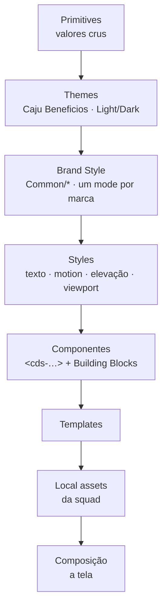
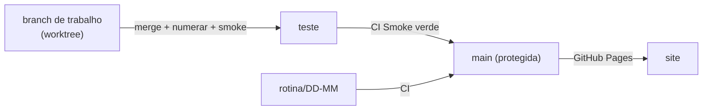

# Castanha DS · Playground de handoff design ↔ código

[](https://github.com/gus-constantino/castanhads-component-teste/actions/workflows/smoke.yml)
[](https://gus-constantino.github.io/castanhads-component-teste/)

Playground público do **Castanha DS**, o design system da Caju. Cada componente da lib `[CastanhaDS] Components` do Figma vira um custom element `<cds-…>` com as mesmas props, variantes, tokens e estados, ao lado da documentação, da tradução para o `castanha-react` e de um painel de saúde do projeto.

**Site:** https://gus-constantino.github.io/castanhads-component-teste/

> HTML, CSS e JS puros, sem dependências e sem transpilar nada. Os scripts de build rodam em Node puro e geram arquivos que o site lê.

---

## Sumário

- [O que tem aqui](#o-que-tem-aqui)
- [Princípios](#princípios)
- [Arquitetura](#arquitetura)
- [Estrutura de pastas](#estrutura-de-pastas)
- [Como rodar](#como-rodar)
- [Comandos](#comandos)
- [Fluxo de trabalho](#fluxo-de-trabalho)
- [Padrões de desenvolvimento](#padrões-de-desenvolvimento)
- [Receitas](#receitas)
- [Qualidade e CI](#qualidade-e-ci)
- [Integração com o castanha-react](#integração-com-o-castanha-react)
- [MCP do Castanha DS](#mcp-do-castanha-ds)
- [Conteúdo e escrita](#conteúdo-e-escrita)
- [Repositório público](#repositório-público)
- [Documentos](#documentos)

---

## O que tem aqui

| Área | O que é | Onde |
|---|---|---|
| **Playground** | 77 componentes e 26 building blocks, cada um com controles iguais às props do Figma, viewport (mobile, tablet, desktop) e tema claro ou escuro | `components/<id>/` · rota `#/<id>` |
| **Documentação** | Tabs de uso, anatomia, estilos, acessibilidade, diretrizes, motion e conteúdo, carregadas sob demanda | `components/<id>/<id>.docs.js` |
| **No React** | Código do `castanha-react` gerado a partir das props como estão no Figma | `scripts/react-kit.js` · `integration/` |
| **Recursos** | Caju - Tema (tokens), Camadas, Conteúdo, Patterns, Treinamento, Capacitações, Personas, Agentes e Skills, MCP, FAQ e Changelog | `resources/<id>/` |
| **Composições** | Peças montadas com tokens e componentes do DS onde o DS ainda não tem o componente (prefixo `cmp-`) | `compositions/<id>/` |
| **Templates** | Trechos de tela do Figma de templates (ex.: cabeçalho do Sponsor) | `templates/` |
| **Relatório** | Painel do projeto: números, sinais vitais, ritmo, publicação na lib, débitos e decisões, lidos direto dos `.md` | `scripts/report.js` · rota `#/relatorio` |
| **MCP** (em breve) | Servidor MCP que dá a assistentes de IA o conteúdo do DS e gera e revisa JSX | `mcp/` · `dist/mcp/` |

---

## Princípios

1. **Figma primeiro.** O código faz o que o Figma faz hoje, mesmo quando parece errado. A divergência vai para o [`docs/CONFERIR.md`](docs/CONFERIR.md) e é corrigida no Figma. Exceção só com decisão registrada (regra D40).
2. **Sempre Castanha DS.** A interface do próprio playground usa componentes e tokens do DS, e nada além. Valor cru (px, hex, ms, cubic-bezier) é bloqueado pela auditoria. Quando o DS não tem a peça, ela vira composição `cmp-` documentada, nunca um controle feito à mão.
3. **Nome exato do Figma.** Props, variantes e valores com o nome da lib, typo incluído. O typo vai para o CONFERIR.
4. **Sem build no site.** O navegador carrega arquivos estáticos. O que é gerado (tokens, ícones, pacotes, catálogo do MCP) é commitado e conferido pela CI.
5. **Fonte única.** O relatório e o catálogo do MCP leem os mesmos arquivos do repositório (`ROADMAP`, `CONFERIR`, docs), sem cópia.
6. **Acessível e com movimento por token.** Elemento nativo sempre que existir, nome acessível em tudo. Motion sempre com Motion Styles e tokens de duração e easing. `prefers-reduced-motion` desliga as animações.

---

## Arquitetura

As camadas do DS, do valor cru até a tela, também estão explicadas no recurso **Camadas** do site:



No código, o playground se organiza assim:

| Camada | Arquivos | Responsabilidade |
|---|---|---|
| Tokens | `tokens/figma-snapshot.json` → `styles/tokens.css` | `--common-*` em Light e Dark (`html[data-theme]`), text styles `--text-style-*`, elevações, Motion Styles `--motion-*`. Alias `--castanha-*` igual ao pacote `castanha-tokens` |
| Assets | `assets/icons` · `illustrations` · `flags` · `brand` | SVGs do Figma. Ícone = máscara `.cds-icon--<nome>` (gerado) |
| Base da lib | `styles/shared.css` · `scripts/cds-element.js` | Reset, `.cds-icon`, classe base `CDS.Element`, `CDS.create()` |
| Componentes | `components/<id>/` | Custom element, CSS e playground (contrato abaixo) |
| Kits | `playground-kit.js` · `docs-kit.js` · `tokens-kit.js` · `react-kit.js` | Controles do playground, blocos da documentação, mostruário de tokens e painel "No React" |
| Shell | `index.html` · `scripts/app.js` · `styles/playground.css` · `docs.css` · `report.css` | Menu, rotas, tema, viewport, cabeçalho, busca e relatório. Não faz parte da lib |
| Pacotes | `dist/cds.css` · `dist/cds.js` · `dist/search.json` · `dist/mcp/` | Concatenação na ordem de dependência, índice de busca e MCP. **Gerados** |

---

## Estrutura de pastas

```
index.html                     shell (blocos de <link>/<script> GERADOS pelo build-index)
components/<id>/
  <id>.js                      custom element <cds-…> (estende CDS.Element, @deps no JSDoc do topo)
  <id>.css                     estilos (só tokens)
  <id>.playground.js           CDS.register({ id, name, category, mount… }) + controles
  <id>.docs.js                 opcional: CDS.docs[id] = { tabs: [{ id, title, blocks }] } (só dados, sob demanda)
compositions/<id>/             peças cmp-* (o DS ainda não tem o componente)
resources/<id>/<id>.js         recursos (páginas de doc, sem mount)
templates/                     trechos de templates do Figma
tokens/figma-snapshot.json     tokens lidos do Figma via MCP
styles/
  tokens.css · icons.css       GERADOS
  shared.css                   base da lib
  playground.css · docs.css · report.css   shell, documentação e relatório
scripts/
  cds-element.js               classe base dos componentes
  playground-kit.js            CDS.register + controles (seg, toggle, text, range, select, iconSwap, nested…)
  docs-kit.js                  blocos da documentação (h2, p, cards, dodont, steps, table, faq…)
  tokens-kit.js · react-kit.js · report.js · app.js
  build-index.js               ordem de dependência, ?v=hash, dist/, índice de busca, catálogo do MCP
  build-tokens.js · build-assets.js · search-index.js
  integration/                 manifesto e checks Figma × castanha-react × playground
  mcp/                         catálogo e arquivo único do MCP
  dev/                         smoke, audit-ui, numerar, changelog, extratores de SVG
integration/                   dados da integração React (mapas curados, relatórios de saúde)
mcp/                           servidor MCP (stdio e HTTP), gerador e revisor de JSX, testes
tests/                         smoke.html · smoke.js · smoke-docs.js · expected.js · ultimo-smoke.json
docs/                          ROADMAP, CONFERIR, ARCHITECTURE, SAUDE-TECNICA, changelog, zeroheight…
dist/                          GERADO: cds.css, cds.js, search.json, mcp/
```

Arquivo marcado como **GERADO** não se edita à mão: rode o script correspondente.

---

## Como rodar

O site precisa de um servidor estático, porque são vários arquivos e as docs carregam sob demanda. Abrir `index.html` como `file://` não funciona.

```bash
python3 -m http.server 8765 --bind 127.0.0.1
```

Abra http://127.0.0.1:8765. Pré-requisitos: Node 18 ou mais novo para os scripts, e Chrome para o smoke headless.

---

## Comandos

| Comando | O que faz |
|---|---|
| `node scripts/build-index.js` | Regera o `index.html`, o `tests/smoke.html`, o `dist/` (pacotes, índice de busca e MCP) e o painel `docs/SAUDE-TECNICA.md`. **Rode depois de qualquer mudança** |
| `node scripts/build-index.js --smoke` | Faz o mesmo e roda o smoke dos componentes e das docs no Chrome headless |
| `node scripts/dev/audit-ui.js` | Reprova valor cru (px, hex, ms, easing) e controle HTML feito à mão na UI do playground |
| `node mcp/test.js` | Testa o MCP: handshake, ferramentas, resources, prompts e o cruzamento gerar → revisar JSX |
| `node scripts/dev/numerar.js` | Numera as linhas novas `D+nome` e `C+nome` do ROADMAP e do CONFERIR. Com `--check`, confere sem alterar |
| `node scripts/dev/changelog.js build` | Regera o recurso Changelog a partir de `docs/changelog/releases.json` (`check` valida as regras) |
| `node scripts/build-tokens.js` | `tokens/figma-snapshot.json` → `styles/tokens.css` |
| `node scripts/build-assets.js` | `assets/` → `styles/icons.css` + `scripts/assets-manifest.js` |
| `node scripts/integration/daily.js` | Leitura diária da integração com o `castanha-react` (rotina) |

---

## Fluxo de trabalho



- **`main` é protegida.** Só entra commit com o check **Smoke** verde, em fast-forward. Ela publica o site.
- **`teste` é a branch de integração.** Vários chats e pessoas trabalham ao mesmo tempo, cada um em sua branch ou worktree. Antes de publicar, traga a `teste` (`git merge origin/teste`).
- **Merge na `main` quando pedido.** O caminho é `teste` → CI verde → `main`. Se a CI da `teste` for cancelada por outro push, publique o mesmo commit numa branch `rotina/<nome>`: ela roda a CI sem cancelar ninguém. Depois avance a `main` e apague a branch.
- **Decisões e divergências com apelido.** Linha nova no ROADMAP (`D…`) ou no CONFERIR (`C…`) nasce como `D+nome` ou `C+nome`. Depois do merge, `node scripts/dev/numerar.js` dá o número. Nunca escolha o número à mão. Na linha D, a última coluna é a data (`05/10`).
- **Checagens sem pipe.** Rode `numerar.js --check`, `audit-ui.js` e `mcp/test.js` sem `| tail`, senão o código de saída se perde.
- **Commits** em português, dizendo o que mudou e onde, com o número da decisão (`D214`) quando houver.

---

## Padrões de desenvolvimento

### Contrato do componente

1. **Custom element em light DOM** (sem Shadow DOM), estendendo `CDS.Element`: `render()`, `flag()`, `text()`, `a11yName()`, `define()`. Assim os tokens cascateiam, o tema funciona por `data-theme` e o viewport por `[data-viewport]`.
2. **Atributos = props do Figma em kebab-case.** Variant → atributo de valor (`appearance="warning"`). Boolean `Show X` ligado por padrão → `show-x="false"` desliga. Text → atributo de texto, com o texto padrão do Figma.
3. **Estado visual por CSS:** `:hover` = Hovered, `:active` = Pressed, `:focus-within` = Is Active. Valores em custom properties privadas (`--_bg`, `--_fg`, `--_bd`) trocadas por seletor.
4. **Stroke INSIDE** = `box-shadow: inset 0 0 0 <w> <cor>`, que não desloca o layout.
5. **Nested instance = componente real** (`<cds-icon>`, `<cds-badge>`…). O pai expõe referências (`iconEl`, `button`) e troca cor por `--cds-icon-color`.
6. **Só tokens.** Cor, espaço, raio, tipografia (`font: var(--text-style-…)`), elevação e motion (`var(--motion-hover-in-01-timing)`, `var(--common-motion-easing-…)`).
7. **Eventos** com prefixo `cds-` e `bubbles: true`: `cds-change`, `cds-remove` (cancelável), `cds-complete`, `cds-toggle`, `cds-visibility-change`.
8. **Acessibilidade:** elemento nativo (`<button>`, `<a>`, `<input>`). Decorativo com `aria-hidden`. Com `label`, `role="img"` e `aria-label`. Contraste WCAG 2.2 AA, com Disabled isento.
9. **Dependências** declaradas no topo: ` * @deps icon badge` (ou `—`). O `build-index.js` ordena e falha em ciclo ou dependência inexistente.

```js
// Exemplo simplificado (o render real monta os filhos na primeira vez e guarda as referências)
/**
 * Tag · Feedback
 * @deps icon
 */
(function(){
  class CdsTag extends CDS.Element {
    static get observedAttributes(){ return ["label", "appearance", "show-lead-item"]; }
    render(){
      // flag(): boolean do Figma ligado por padrão · text(): texto com o padrão do Figma
      this.iconEl.hidden = !this.flag("show-lead-item");
      this.labelEl.textContent = this.text("label", "Tag");
    }
  }
  CdsTag.define("cds-tag");
})();
```

### CSS

- Classe do componente com prefixo `cds-` (`.cds-btn`, `.cds-acc__slot`) e BEM leve (`__parte`, `is-estado`).
- Shell e páginas com prefixo próprio: `pg-` (playground e docs), `rp-` (relatório), `cmp-` (composições).
- Sem valor cru fora de `@media`: CSS não aceita `var()` em media query, e esse é o único caso de exceção.
- Animação de entrada com `animation-fill-mode: backwards`. Com `both`, o transform fica ativo depois da entrada e os Tooltips (`position: fixed`) se posicionam errado.

### Documentação

As docs são **só dados**. O `docs-kit.js` transforma blocos em UI do DS:

```js
CDS.docs["tag"] = { tabs: [
  { id: "uso", title: "Uso", blocks: [
    { h2: "Quando usar" },
    { p: "Texto com `código` e **destaque**." },
    { dodont: [{ kind: "do", text: "…" }, { kind: "dont", text: "…" }] },
    { table: { head: ["Prop", "Valores"], rows: [["Appearance", "neutral, positive…"]] } }
  ] }
] };
```

Blocos disponíveis: `h2` `h3` `p` `note` `alert` `ul` `ol` `cards` `display` `compare` `specimens` `guides` `dodont` `anatomy` `props` `specs` `steps` `code` `table` `shortcuts` `glossary` `faq` `video(s)` `release(s)` `persona` `palette` `simulate` e `tokens` (do `tokens-kit`). Um bloco novo também precisa de um leitor em `scripts/mcp/build-catalog.js`, para o MCP ler o texto.

### Recursos, composições e templates

- **Recurso:** `CDS.register({ id, name, resource: true, order })` + `CDS.docs[id]`. A seção do menu é definida em `RES_SECTIONS` (`scripts/app.js`). Link externo entra em `links` da seção e abre em nova guia.
- **Composição:** elemento `cmp-*` montado com tokens e componentes do DS. O cabeçalho explica por que existe e quando apagar. Tem uma linha no CONFERIR.
- **Template:** trecho de um arquivo de templates do Figma, montado com componentes do DS.

---

## Receitas

<details>
<summary><strong>Adicionar um componente</strong></summary>

1. Crie `components/<id>/` com `<id>.js`, `<id>.css` e `<id>.playground.js`. No `.js`, declare `@deps`.
2. No playground, chame `CDS.register({ id, name, category, block, figma, zeroheight, mount(ctx) })`. `category` é a página do Figma, que agrupa o menu. `block: true` coloca o componente em Building blocks.
3. Registre o tamanho esperado do Figma em `tests/expected.js`.
4. Rode `node scripts/build-index.js --smoke`.
5. Se o componente tem par no `castanha-react`, crie o mapa `integration/prop-map/<id>.json` e rode o manifesto.
</details>

<details>
<summary><strong>Documentar um componente</strong></summary>

1. Crie `components/<id>/<id>.docs.js` com `CDS.docs[id] = { tabs: [...] }`.
2. Motion: um card por transição, com o gatilho e o Motion Style `/01`. Nunca escreva duração ou easing à mão.
3. Rode o build com `--smoke`. O smoke das docs abre cada tab no desktop e em 375 px e confere erro e a11y.
</details>

<details>
<summary><strong>Atualizar tokens, ícones e ilustrações</strong></summary>

1. **Tokens:** atualize `tokens/figma-snapshot.json` (lido via Figma MCP) e rode `node scripts/build-tokens.js`.
2. **Assets:** exporte o SVG do Figma para `assets/icons/<categoria>/` ou `assets/illustrations/` com o nome do componente e rode `node scripts/build-assets.js`.
3. Rode `node scripts/build-index.js`.
</details>

<details>
<summary><strong>Registrar uma decisão ou divergência</strong></summary>

1. ROADMAP §4: `| D+<apelido> | **Título**: o que foi decidido e por quê | 05/10 |`.
2. CONFERIR: `| C+<apelido> | … |`, na seção do tipo de ajuste.
3. Depois de trazer a `teste`, rode `node scripts/dev/numerar.js` e `--check`.
</details>

<details>
<summary><strong>Publicar no site</strong></summary>

```bash
git fetch && git merge origin/teste
node scripts/dev/numerar.js
node scripts/dev/numerar.js --check
node scripts/build-index.js --smoke
node scripts/dev/audit-ui.js
node mcp/test.js
git push origin HEAD:teste
```

Com a CI verde no commit, avance a `main` em fast-forward: `git push origin HEAD:main`.
</details>

---

## Qualidade e CI

A CI ([`.github/workflows/smoke.yml`](.github/workflows/smoke.yml)) roda em push na `main`, na `teste` e em `rotina/**`, e em PR:

| Passo | Reprova quando |
|---|---|
| Build + smoke (Chrome headless) | Um componente não monta, não define o elemento, sai de ±1 px do Figma ou falha em a11y (claro, escuro e mobile 360). Uma doc dá erro ou falha em a11y no desktop ou em 375 px |
| Auditoria da UI | Aparece valor cru ou controle HTML feito à mão fora das exceções conhecidas |
| MCP | Handshake, ferramentas, resources, prompts ou o JSX gerado dos mapas não passam |
| Numeração D/C | Há número repetido ou apelido sobrando |
| Changelog | Há e-mail, menção, link interno ou link com rastreio |
| Build em dia | `index.html`, `dist/` ou `tests/smoke.html` commitados não batem com o build |

Avisos (contraste e largura no mobile) não reprovam: ficam no CONFERIR e no painel **Relatório › Saúde técnica**.

---

## Integração com o castanha-react

Decisões D149 a D160 no ROADMAP:

- **Manifesto** (`scripts/integration/build-manifest.js`): lê o monorepo oficial (staging e Code Connect) e gera `integration/react-data.js`.
- **Mapas curados** (`integration/prop-map/<id>.json`): traduzem prop do Figma para prop do React. Estão no painel **No React** de cada componente e no `gerar_jsx` do MCP.
- **Check da stack:** Figma × castanha-react × playground (`check-stack.js`), com assets e tokens (`check-assets.js`) e JSX validado pelo TypeScript (`check-jsx.js`). O resultado vai para a aba **Stack React** do relatório.
- **Leitura diária:** `scripts/integration/daily.js`, rodado pela rotina.

O repositório é público: nenhum código-fonte do `castanha-react` é copiado. Entram nomes de props, tipos e mapas.

---

## MCP do Castanha DS

> **Em breve.** Está em teste e ainda não foi oferecido ao time.

O servidor dá a assistentes de IA (Claude, Cursor, VS Code) os componentes, as docs, as props do Figma e do React, os tokens, os ícones, as ilustrações e as diretrizes. Ele também gera e revisa JSX, sem alterar nada: lê o conteúdo publicado.

- Código: [`mcp/`](mcp/), com instruções em [`mcp/README.md`](mcp/README.md).
- Arquivo único para baixar: `dist/mcp/castanha-mcp.js` (gerado no build).
- Plano: [`docs/local/PLANO-MCP.md`](docs/local/PLANO-MCP.md).

---

## Conteúdo e escrita

Toda prosa (docs, relatórios, commits, comentários) segue os princípios de conteúdo do Castanha:

- Presente do indicativo, sem pleonasmo e sem "fácil", "rápido", "simples" ou "só".
- Erro sempre com o próximo passo.
- Sem CAPS para ênfase e sem ponto e vírgula.
- Sem ponto final em título, item de lista e label.
- Prosa em pt-BR, identificador em inglês, termos da Caju como a Caju escreve.
- Nome exato do Figma em props e variantes.

---

## Repositório público

Este repositório é público. Não entram:

- nomes de pessoas, e-mails ou menções
- links internos (Slack, Storybook e Widgetbook atrás de VPN), chaves de tarefa ou dados de clientes
- código-fonte de repositórios privados, como o `castanha-react` ou plugins internos
- tokens, segredos ou credenciais
- pastas locais de trabalho (`docs/local/`, exceto o plano do MCP, `.claude/` e `skills/`).

---

## Documentos

| Documento | Para quê |
|---|---|
| [`docs/ROADMAP.md`](docs/ROADMAP.md) | Lotes, inventário da lib, decisões (D), dúvidas e status |
| [`docs/CONFERIR.md`](docs/CONFERIR.md) | Divergências Figma × esperado (C), por tipo de ajuste |
| [`docs/ARCHITECTURE.md`](docs/ARCHITECTURE.md) | Camadas, contrato de componente, infraestrutura, diário e receitas |
| [`docs/SAUDE-TECNICA.md`](docs/SAUDE-TECNICA.md) | Último smoke, peso e numeração (gerado) |
| [`integration/SAUDE-STACK.md`](integration/SAUDE-STACK.md) | Check Figma × castanha-react × playground (gerado) |
| [`docs/CHECK-PROPS.md`](docs/CHECK-PROPS.md) | Conferência das props do Figma |
| [`docs/PLANO-UI-DS.md`](docs/PLANO-UI-DS.md) | UI do playground com componentes e tokens do DS (D69) |
| [`docs/PLANO-DOCS.md`](docs/PLANO-DOCS.md) | Plano da documentação de todos os componentes |
| [`docs/PLANO-HUB.md`](docs/PLANO-HUB.md) | Plano do Hub (Início) |
| [`docs/TABLE-LINHAS-X-COLUNAS.md`](docs/TABLE-LINHAS-X-COLUNAS.md) | Por que a Table é por linhas (D62) |
| [`docs/zeroheight/`](docs/zeroheight/) | Textos das docs no formato do zeroheight |
| [`docs/changelog/releases.json`](docs/changelog/releases.json) | Dados do Changelog |
